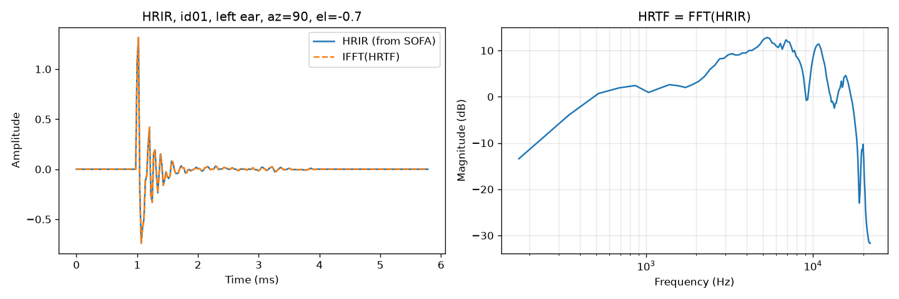
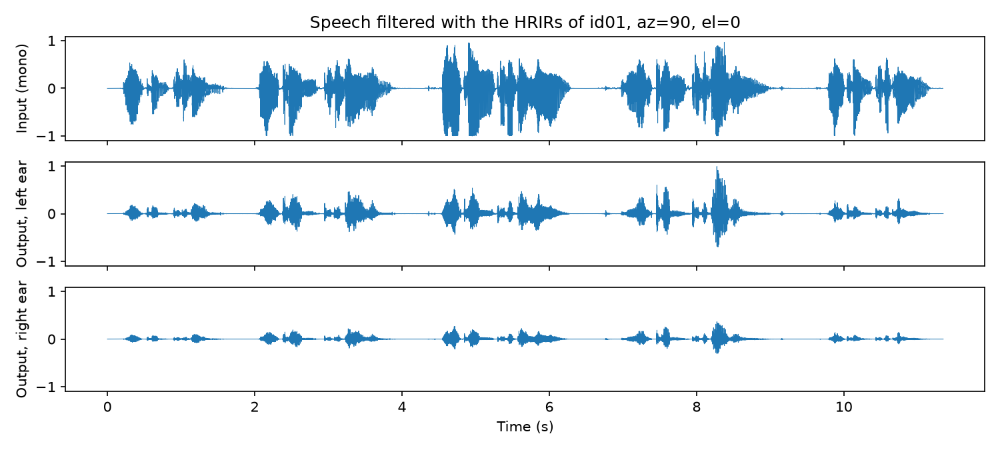
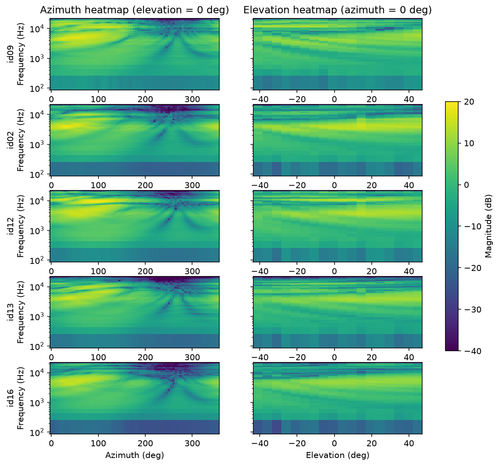
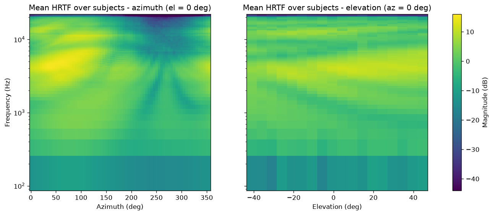
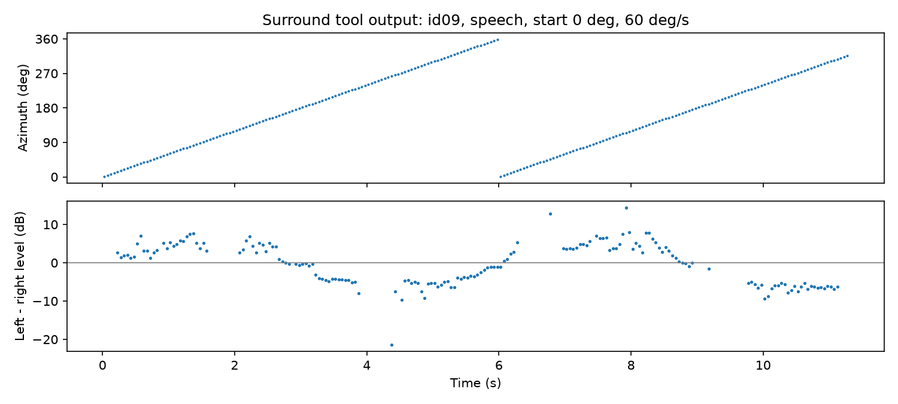

# Project 3: Head-Related Transfer Functions

**Wenrui Chen, Oct 24, 2026**

## 1. HRTF Overview

**What HRTFs are.** A head-related transfer function (HRTF) describes how a sound from a given direction is filtered by the listener's head, torso and outer ears (pinnae) before it reaches each eardrum. It is defined per ear and per direction (azimuth, elevation, and sometimes distance). Its time-domain counterpart is the head-related impulse response (HRIR); the two are related by the Fourier transform. The HRTF pair carries the three main localization cues: the interaural time difference (ITD), the interaural level difference (ILD, caused mainly by head shadowing at high frequencies), and direction-dependent spectral peaks and notches created by the pinna, which resolve elevation and front/back.

**Measurement and representation.** HRTFs are usually measured in an anechoic chamber. Small microphones are placed at the entrance of the subject's (or a dummy head's) ear canals, and a loudspeaker plays a test signal such as an exponential sine sweep from many positions on a sphere around the head. Deconvolving the recordings gives one HRIR per ear and direction, typically a few hundred samples long. The results are stored in the SOFA format (AES69), which holds an array of impulse responses (directions × ears × samples) together with the source positions and the sampling rate.

**Applications.** HRTFs are the core of binaural rendering: filtering a mono signal with the HRIR pair of a direction makes it appear to come from that direction over headphones. This is used in virtual and augmented reality, games, spatial-audio music and film playback, teleconferencing, hearing research and hearing aids. Because HRTFs depend on individual anatomy, using a non-individual HRTF can cause front/back confusion, elevation errors and in-head localization.

## 2. Visualizing HRTF Data

**(a) File structure.** Each SOFA file stores the HRIRs of 1296 directions for the left and right ear (256 samples each, 44.1 kHz). The directions form a grid of 72 azimuths (0°–355° in 5° steps, 90° = left) and 18 elevations (−41° to +45°), indexed as azimuth index × 18 + elevation index. Figure 1 shows the HRIR of subject id01, left ear, at azimuth 90° and elevation 0°.

**(b) HRIR ↔ HRTF.** The HRTF is obtained from the HRIR with the FFT, and the IFFT gives back the original HRIR (Figure 1).

*Figure 1. HRIR of id01, left ear, azimuth 90°, elevation 0° (left) and its HRTF magnitude (right).*

**(c) Applying an HRIR.** Filtering the speech clip with the left and right HRIRs of azimuth 90° places the voice on the listener's left (Figure 2, 2c_id01_speech_az90_el0.wav).

*Figure 2. Speech filtered with the HRIRs of id01 at azimuth 90°: input (top), left-ear output (middle), right-ear output (bottom).*

**(d) Heatmaps.** Figure 3 shows the left-ear azimuth heatmap (elevation 0°) and elevation heatmap (azimuth 0°) side by side for the five subjects used in Section 4.

*Figure 3. Azimuth heatmaps (left) and elevation heatmaps (right), left ear, for the five subjects used in Section 4.*

**(e) Similarities and differences across subjects.**

1. **Azimuth:** all subjects are loudest when the source is on the same side as the ear (0°–180°) and much weaker on the opposite side around 270°, where the head blocks the sound. This difference grows with frequency.
2. **Elevation:** all subjects show a notch between about 6 and 9 kHz that moves to higher frequencies as the source rises.
3. **Inter-subject differences:** below about 4 kHz the subjects are nearly identical. Above about 5 kHz the positions and depths of the peaks and notches differ from subject to subject, because they depend on the shape of each person's ear.

**(f) Mean HRTF and MSE.** Figure 4 shows the mean magnitude over all 20 subjects. The MSE between each subject and the mean was computed for both heatmaps (Table 1). Along azimuth, id09 is closest to the mean (MSE 22.8 dB²) and id02 is farthest (88.5 dB²). Along elevation, id14 is closest (22.9 dB²) and id08 is farthest (121.6 dB²).

*Figure 4. Mean HRTF over all 20 subjects: azimuth heatmap (left) and elevation heatmap (right).*

*Table 1. MSE between each subject and the mean HRTF.*

| Subject | MSE azimuth (dB²) | MSE elevation (dB²) | Subject | MSE azimuth (dB²) | MSE elevation (dB²) |
|---|---|---|---|---|---|
| id01 | 50.53 | 73.16 | id11 | 44.42 | 65.90 |
| id02 | 88.53 | 55.62 | id12 | 37.02 | 34.32 |
| id03 | 79.34 | 118.31 | id13 | 82.62 | 86.31 |
| id04 | 36.03 | 33.53 | id14 | 29.95 | 22.87 |
| id05 | 27.20 | 25.65 | id15 | 65.09 | 83.38 |
| id06 | 23.20 | 28.82 | id16 | 78.68 | 68.73 |
| id07 | 58.29 | 58.74 | id17 | 31.22 | 23.92 |
| id08 | 72.20 | 121.61 | id18 | 37.73 | 35.01 |
| id09 | 22.84 | 23.59 | id19 | 29.01 | 30.11 |
| id10 | 31.89 | 30.54 | id20 | 61.40 | 73.91 |

## 3. Surround Sound Tool

The tool is the function spatialize(sofa_path, audio_path, az_start, omega) in project3.py. It takes the HRTF file of one subject, an audio sample, a starting azimuth and a rotation speed in degrees per second. It outputs a stereo file in which the sound moves around the listener at a fixed elevation (0°).

The audio is cut into short overlapping frames. For each frame, the current azimuth is computed from the starting angle and the speed, and the frame is windowed and filtered with that direction's left and right HRIRs. The filtered frames are added back together with overlap-add (OLA), so the change from one HRIR to the next is a smooth crossfade without clicks. Finally, the output is normalized to avoid clipping. Figure 5 shows an example output: while the source is on the left (0°–180°) the left ear is louder, and while it is on the right (180°–360°) the right ear is louder.

*Figure 5. Output of the surround tool for id09, speech, starting at 0° and rotating at 60°/s: azimuth (top) and left − right level difference (bottom).*

## 4. Listening Experiments

The tool was applied to all five audio samples for five subjects: id09 (closest to the mean HRTF), id02 (farthest from the mean HRTF) and three randomly selected subjects, id12, id13 and id16. The source starts in front (0°) and rotates at 60°/s, i.e. front → left → back → right every 6 s. The outputs were compared over headphones.

### 4a. Listening analysis

1. **How the perceived direction matches the azimuth trajectory.** For all five subjects the sound clearly follows the trajectory front → left → back → right. Left and right are the clearest, matching the large left/right difference in the azimuth heatmaps (Figure 3). The main error is front/back confusion: front and back are sometimes hard to tell apart.
2. **Variations in loudness or frequency balance with direction.** The sound is loudest when the source is at the left or right and weaker in front and behind. This agrees with the heatmaps, where the ear facing the source is strongly boosted and the far ear is attenuated, mostly at high frequencies.
3. **How the sound differs for the subject farthest from the mean.** id02 is still localized correctly, but its speech sounds much darker than the other subjects. Its HRTF has less high-frequency energy than the mean HRTF (Figure 4), which matches its largest MSE. id09, the subject closest to the mean, sounds the clearest.

### 4b. Preferred HRTF: id09

- **Sound quality:** clear and natural on both speech and music, without the dull sound of id02.
- **Positional accuracy:** left and right are very clear, the sound is perceived outside the head, and positions are easy to distinguish. It is also the subject closest to the mean HRTF.
- **Smoothness during azimuth changes:** the rotation is continuous, with no clicks or jumps.
