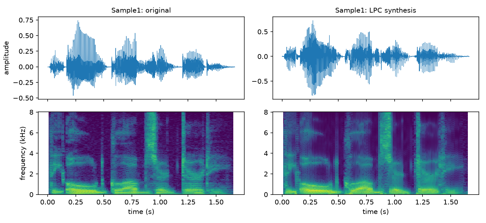
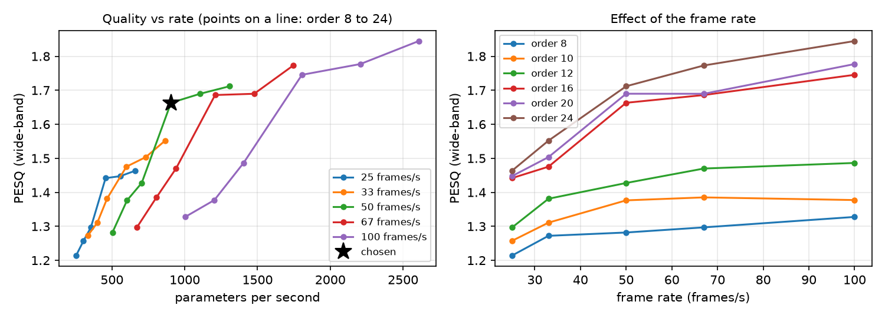
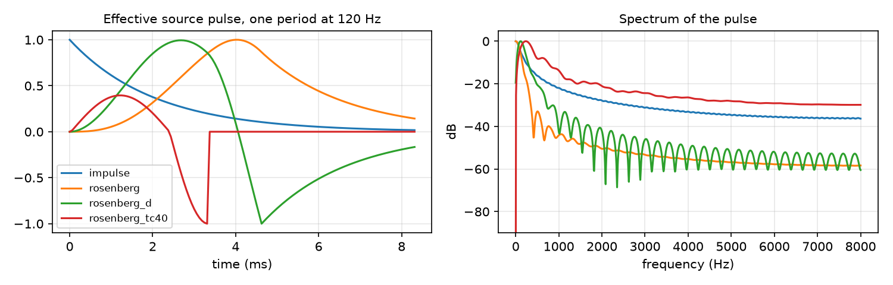
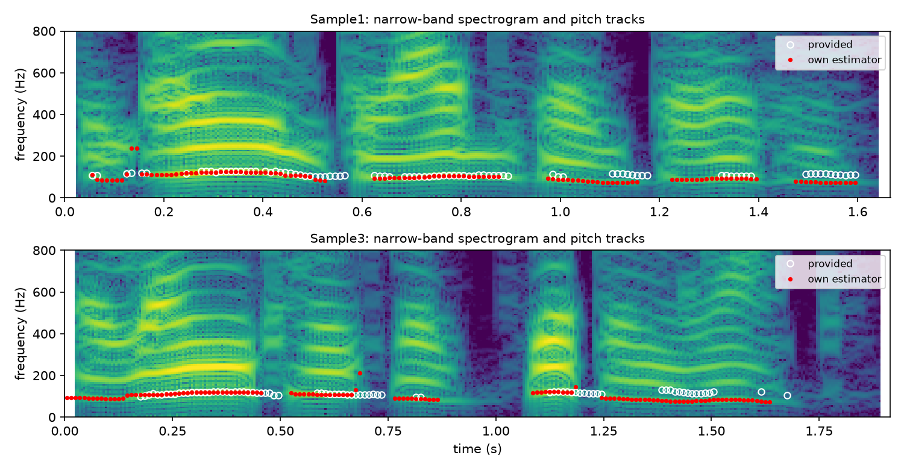

# Project 4: Linear Predictive Coding

**Wenrui Chen, Nov 12, 2026**

## 1. The LPC vocoder

**Transmitter.** The speech (16 kHz) is pre-emphasized with 1 − 0.97z⁻¹ and cut into frames. For each frame the transmitter sends p prediction coefficients a_k, one gain G and one pitch value (0 means unvoiced), so a frame costs p + 2 parameters. The coefficients come from the autocorrelation method: the frame is multiplied by a Hamming window, its autocorrelation r[0..p] is computed, and the normal equations are solved with the Levinson-Durbin recursion. Both steps are written from scratch; no `lpc` or `levinson` library function is used (library calls are limited to audio I/O, `scipy.signal.lfilter` for running the synthesis filter, plots and the PESQ score). The gain is G = sqrt(E / Σw²), where E is the final prediction error energy of the recursion and w the window, so that an excitation with unit power reproduces the power of the frame.

**Receiver.** The receiver builds an excitation with unit power and passes it through the all-pole filter G/A(z), followed by de-emphasis. Unvoiced frames use white Gaussian noise. Voiced frames use one pulse per pitch period. The position of the next pitch pulse is kept from frame to frame: when a new voiced frame starts, the next pulse is placed one (new) period after the last pulse of the previous frame instead of restarting at the frame boundary, which avoids an irregular period at every boundary. The filter coefficients change once per frame (no interpolation), and the filter memory (the last p output samples) is carried into the next frame, so the output is continuous.

**Settings.** The final system uses order p = 16, 50 frames per second (20 ms hop, no overlap of the transmitted frames), a 30 ms Hamming analysis window centered on each frame (so neighbouring analysis windows overlap by 10 ms), and a tilt-compensated Rosenberg pulse (Section 4). These choices come from the comparisons in Sections 3 and 4.

**Quality measures.** Since the vocoder does not preserve the waveform, SNR is not meaningful. I use two measures: wide-band PESQ (the `pesq` Python package named in the assignment; score from 1 to 4.64, higher is better) and a log-spectral distance (LSD, in dB, lower is better) computed between the short-time power spectra of the original and the synthesis after averaging them into 32 bands of 250 Hz. LSD measures how well the spectral envelope and level are reproduced; it does not react to the type of excitation, which PESQ does (Section 2).

## 2. Results on the 10 provided files and rate

| File | Parameters/s | PESQ | LSD (dB) | File | Parameters/s | PESQ | LSD (dB) |
|---|---|---|---|---|---|---|---|
| Sample1 | 907 | 1.61 | 3.85 | Sample6 | 901 | 1.69 | 3.70 |
| Sample2 | 907 | 1.58 | 3.55 | Sample7 | 902 | 1.51 | 3.94 |
| Sample3 | 902 | 1.59 | 3.80 | Sample8 | 909 | 1.50 | 3.63 |
| Sample4 | 904 | 2.15 | 3.34 | Sample9 | 912 | 1.86 | 3.87 |
| Sample5 | 908 | 1.50 | 3.99 | Sample10 | 902 | 1.66 | 3.75 |
| | | | | **Mean** | **905** | **1.66** | **3.74** |

**Average rate.** Each frame carries 16 + 2 = 18 parameters and there are 50 frames per second, which gives about 900 parameters (samples) per second; the measured average is 905 because the last frame of a file is partial. The original signal has 16000 samples per second, so the compression is 17.7 times in samples per second. No quantizer was implemented. If every parameter were stored as a 16-bit number the rate would be 14.5 kbit/s, against 256 kbit/s for the 16-bit PCM original; this is an upper bound, since LPC parameters can be quantized with far fewer bits.

Figure 1 compares the original and the synthesis of Sample1. The formant tracks, the fricative noise above 4 kHz and the energy contour are reproduced. The waveform itself is different, because the phase of the original is not transmitted.

*Figure 1. Sample1: original (left) and LPC synthesis from 905 parameters per second (right).*

## 3. Compression rate against quality; frame rate

I varied the order (8 to 24) and the frame rate (25 to 100 frames/s) and measured the mean PESQ over the 10 files (Figure 2). Mean LSD moves the same way: it falls from 5.85 dB (order 8, 25 frames/s, 253 parameters/s) to 2.87 dB (order 24, 100 frames/s, 2608 parameters/s).

*Figure 2. Left: PESQ against parameters per second; each line is one frame rate and its points are orders 8, 10, 12, 16, 20, 24. Right: PESQ against frame rate for each order.*

**Order.** At 16 kHz the signal has about eight formants up to 8 kHz, and the usual rule of thumb (one pole pair per kHz of bandwidth plus a few poles for the source) points to an order near 16 to 18. The measurements agree: going from 12 to 16 gives the largest step (1.43 to 1.66 PESQ at 50 frames/s), while 20 and 24 add only 0.03 and 0.05 for 22% and 45% more parameters.

**Frame rate.** Quality rises quickly up to 50 frames/s and slowly after that. At order 16, PESQ is 1.44 at 25 frames/s, 1.48 at 33, 1.66 at 50, 1.69 at 67 and 1.75 at 100. With 40 ms frames (25 frames/s) the vocal tract changes inside a frame, so transitions are smeared and one voicing decision has to cover several phonemes. Above 50 frames/s the filter is updated faster than the articulators move, so doubling the rate to 100 frames/s buys 0.09 PESQ for twice the parameters. **50 frames/s works best as a trade-off**: in the left panel of Figure 2 the chosen point (order 16, 50 frames/s, 905 parameters/s) is at the knee, and no tested setting with fewer parameters comes within 0.1 PESQ of it. The voicing information is available at 100 frames/s, but it is only needed at the LPC frame rate: a frame is called voiced if at least half of the 10 ms voicing frames inside it are voiced, and its pitch is their median.

**Window length.** At 50 frames/s, a 30 ms analysis window gives PESQ 1.66, against 1.62 for 20 ms and 1.65 for 40 ms. The window has to hold at least two pitch periods of the lowest voices in the set (about 75 Hz, 13 ms), which a 20 ms window barely does.

## 4. Glottal pulse shapes

Because of the pre-emphasis at the transmitter and the de-emphasis at the receiver, an impulse excitation is equivalent to driving the vocal tract filter with a decaying exponential (Figure 3, blue): the de-emphasis filter plays the role of a simple fixed glottal pulse with a −6 dB/octave tilt. I compared it with the Rosenberg glottal flow pulse (rising half cosine during the opening phase, quarter cosine during the closing phase), scaled with the pitch period.

| Voiced excitation | PESQ | LSD (dB) |
|---|---|---|
| Impulse | 1.60 | 3.63 |
| Rosenberg flow pulse | 1.09 | 16.19 |
| Derivative of the Rosenberg pulse | 1.30 | 9.39 |
| Tilt-compensated Rosenberg, open quotient 70% | 1.54 | 3.71 |
| Tilt-compensated Rosenberg, open quotient 56% | 1.59 | 3.70 |
| Tilt-compensated Rosenberg, open quotient 40% | **1.66** | 3.74 |
| Tilt-compensated Rosenberg, open quotient 25% | 1.64 | 3.91 |

Putting the Rosenberg pulse directly in place of the impulse is much worse. Its spectrum falls by about 12 dB/octave (Figure 3, orange), and the LPC filter was estimated on the real speech, so it already contains the spectral tilt of the speaker's glottal source. The tilt is then applied twice and the high frequencies are lost, which is why LSD jumps to 16 dB. Using the derivative of the pulse (glottal flow plus lip radiation) removes 6 dB/octave of this and is better, but still too dull.

The pulse is useful once the tilt is counted only once. In the "tilt-compensated" version the pulse derivative is passed through the pre-emphasis filter, which cancels the de-emphasis at the output, so the voiced path becomes glottal flow → radiation → vocal tract filter. The long-term spectrum is then close to that of the impulse (LSD 3.7 dB in both cases), and what changes is the shape of the excitation inside a pitch period: the energy is spread over the open phase instead of being concentrated in a single sample. With an open quotient of 40% this gives the best PESQ (1.66 against 1.60 for the impulse), so it is the setting used for the final files. The benefit of the glottal shape is real but small compared with the effect of the order, the frame rate or the voicing.

*Figure 3. Effective source pulse seen by the vocal tract filter (after de-emphasis) for one 120 Hz period, and its spectrum.*

## 5. Voicing

**Estimator.** The voicing estimator is written from scratch and runs at 100 frames/s. For each frame, the signal is low-pass filtered to 900 Hz (windowed-sinc FIR), a 40 ms segment is center-clipped at 30% of its peak, and the normalized autocorrelation is computed for the lags that correspond to 60 to 400 Hz. The frame is voiced if (1) the autocorrelation peak is above 0.45, (2) the zero-crossing rate of the original signal is below 0.2 per sample and (3) the frame level is within 30 dB of the loudest frame. The pitch is taken from the shortest lag whose peak is within 90% of the highest one (to avoid picking a multiple of the period), refined by parabolic interpolation. Finally, isolated single-frame decisions are flipped and the pitch track is smoothed with a 5-point median filter.

**Evaluation.** There is no ground truth, so I compared the estimator with the provided tracks and with narrow-band spectrograms. Against the provided tracks the voiced/unvoiced decision agrees on only 65.7% of the frames. The disagreement is one-sided: of the frames the provided track calls voiced, my estimator calls 14.9% unvoiced, but of the frames it calls unvoiced, mine calls 51.1% voiced (67% of all frames are voiced for my estimator, 46% for the provided track). Where both are voiced, the median pitch difference is 8.5%.

Figure 4 shows why I trust my estimator in most of these frames. In Sample1 the provided track is unvoiced from 0.17 to 0.27 s and in Sample3 before 0.17 s, although the spectrogram shows clear, strong harmonics there; my estimator follows them. At the end of both files the harmonic spacing is about 75 to 90 Hz, which my estimator tracks, while the provided track stays near 110 Hz. My estimator still makes errors, visible as isolated wrong points at voiced/unvoiced boundaries and in low-level segments (for example near 0.13 s in Sample1 and 0.68 s in Sample3).

*Figure 4. Narrow-band spectrograms (0 to 800 Hz) with the provided pitch track (white circles) and my estimator (red dots).*

**Contribution of voicing to the reconstruction.** With everything else fixed, I changed only the voicing information:

| Voicing used at the receiver | PESQ | LSD (dB) |
|---|---|---|
| Own estimator | **1.66** | 3.74 |
| Provided track | 1.24 | 3.82 |
| All frames unvoiced (noise only) | 1.14 | 3.98 |
| All frames voiced (constant median pitch) | 1.30 | 3.67 |

LSD is almost the same in the four cases, because the spectral envelope comes from the a_k and G, which did not change. PESQ changes a lot: with a wrong excitation the envelope is right but a voiced sound is rendered as noise (a whisper) or an unvoiced sound as a buzz. Voicing is therefore the largest single factor in the quality of this vocoder: replacing my estimator by the provided track costs 0.42 PESQ, more than reducing the order from 16 to 8 at the same frame rate (0.38). The provided track scores close to the all-unvoiced case because it marks many voiced frames as unvoiced. The binary voiced/unvoiced model is also a main source of the remaining distortion: sounds with mixed excitation (voiced fricatives, breathy onsets) must be forced into one of the two classes.

## 6. Using the remaining error

The prediction error e[n] = s[n] + Σ a_k s[n−k] is what the pulse/noise model throws away. If the receiver is given e[n] as excitation, the filter 1/A(z) rebuilds the signal exactly. I sent the error with a uniform quantizer of 1 to 4 bits per sample, scaled per frame by the RMS of the error (sent in place of G; the pitch is no longer needed). Rates assume 16 bits per LPC parameter, as in Section 2.

| Excitation | kbit/s | PESQ | LSD (dB) | SNR (dB) |
|---|---|---|---|---|
| Pulse/noise (vocoder) | 14.5 | 1.66 | 3.74 | n/a |
| Error, 1 bit/sample | 29.7 | 1.46 | 3.19 | 2.6 |
| Error, 2 bit/sample | 45.7 | 2.17 | 2.07 | 6.7 |
| Error, 3 bit/sample | 61.7 | 3.04 | 1.37 | 10.7 |
| Error, 4 bit/sample | 77.7 | 3.60 | 0.94 | 13.8 |
| Error, unquantized (16 bit) | 269.7 | 4.64 | 0.00 | exact |

The error has one value per speech sample, so it costs 16 kbit/s for every bit of resolution, more than the whole vocoder stream. Sending it unquantized gives a perfect signal but no compression at all (269.7 kbit/s, above the 256 kbit/s of the original). With 1 bit per sample the rate doubles and PESQ is lower than the vocoder's, because the quantization noise is as large as the error itself. From 2 bits per sample on, the quality passes the vocoder clearly (PESQ 2.17, 3.04, 3.60), at 3 to 5 times its bit rate. The error also removes the dependence on the voicing decision, since the excitation no longer has to be classified.

## 7. Own recording

I recorded the sentence "The synthesized signal is supposed to be of high standard" (6.0 s including about 1.2 s of silence at each end, converted to 16 kHz mono) and used my own voicing estimator. The rows below change one thing at a time from the Part 1 settings.

| Setting (voiced order / unvoiced order / frames per s) | Parameters/s | PESQ | LSD (dB) |
|---|---|---|---|
| Part 1 settings: 16 / 16 / 50 (baseline file) | 901 | 1.86 | 3.55 |
| Silence threshold of the voicing estimator −30 → −40 dB | 901 | 1.95 | 3.55 |
| Unvoiced order 8 (with the −40 dB threshold, as all rows below) | 667 | 1.66 | 4.28 |
| Unvoiced order 12 | 784 | 1.77 | 3.88 |
| Unvoiced order 24 | 1135 | 2.01 | 3.28 |
| Voiced order 10 | 776 | 1.68 | 4.45 |
| Voiced order 14 | 859 | 1.91 | 3.75 |
| 14 / 20 / 50 | 977 | 1.96 | 3.57 |
| **14 / 20 / 40 (optimized file)** | **784** | **1.88** | **3.85** |

**Order of the unvoiced frames.** My first idea for compression was to give the unvoiced frames a lower order, since noise-like sounds are usually said to need few poles. For this sentence that does not work. The unvoiced frames are 60% of the recording, and cutting their order from 16 to 8 lowers PESQ from 1.95 to 1.66 and raises LSD from 3.55 to 4.28 dB; raising it to 24 still improves both. The sentence is full of /s/ and /z/, whose energy lies in the upper half of the 8 kHz band, and with the binary voicing model the "unvoiced" class also contains voiced fricatives, transitions into vowels and the room noise. These frames need as many poles as the vowels. The voiced frames, in contrast, lose little from 16 to 14 (PESQ 1.95 to 1.91) and collapse only at 10.

**Voicing.** With the −30 dB silence rule of Part 1, weak voiced frames of this recording were sent as noise. Lowering the rule to −40 dB (the room noise is at about −45 dB) raises the voiced frames from 37% to 40% and PESQ from 1.86 to 1.95 at no cost in rate. The zero-crossing test matters for the fricatives: without it, 41 more frames (7% of the recording) pass the autocorrelation test and would be buzzed as voiced; nearly all of them are loud frames with a zero-crossing rate above the 0.2 limit.

**Choice.** The optimized setting moves parameters from the voiced to the unvoiced frames (order 14 and 20) and lowers the frame rate to 40 frames/s, which costs 0.08 PESQ against 50 frames/s. It needs 784 parameters per second, 13% fewer than the Part 1 settings (901), with the same PESQ (1.88 against 1.86); its LSD is 0.3 dB higher, so the gain is in compression, not in quality. If quality matters more than rate, the same orders at 50 frames/s give PESQ 1.96 for 977 parameters per second.
